# Week 10 AWS Practice: Quick, Redshift and Athena

**Course:** IDS 706.01.Fa26
**Name:** Shahad Baalkhashir

This README documents the five labs from the *Better together: Amazon Quick, Redshift and Athena* workshop. Each section follows the grading breakdown and shows the key screenshot for that item. Supporting screenshots are linked, and all of them are in the [`screenshots/`](screenshots/) folder.

---

## Track 1: Modernize BI Workloads (20 pts)

### Load and verify Redshift data and the revenue materialized view
I created the `customer`, `orders` and `lineitem` tables on the provisioned Redshift cluster and loaded the 10 GB TPC-H data from S3 with `COPY`. The row counts confirm the load: 1,500,000 customers, 15,000,000 orders and 59,986,052 line items.

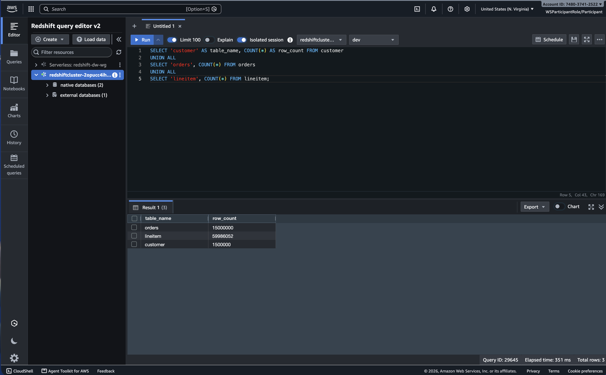

I then created the materialized view `mv_customer_revenue`, which pre-computes each customer's net revenue (`SUM(l_extendedprice * (1 - l_discount))`) and distinct order count. Querying it returned 10 rows in 163 ms, because Redshift reads the stored result instead of re-joining 60 million line items. ([screenshot](screenshots/1a_revenue_mv.png))

### Validate a Quick data source and dataset
I connected Quick to Redshift (data source `customer-rev-datasource`) and created the `mv_customer_revenue` dataset from the materialized view, in direct query mode.

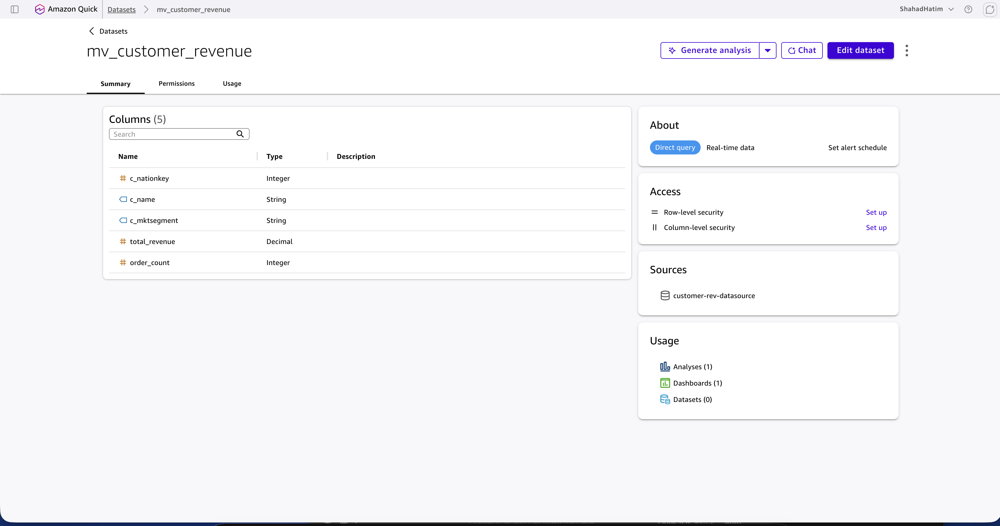

### Publish a useful dashboard
I published the **Market Segment Dashboard**. It answers: *how are orders split across customer market segments?* The 15,000,000 orders are almost evenly spread, at about 20% per segment (BUILDING 3,004,382 down to HOUSEHOLD 2,990,828).

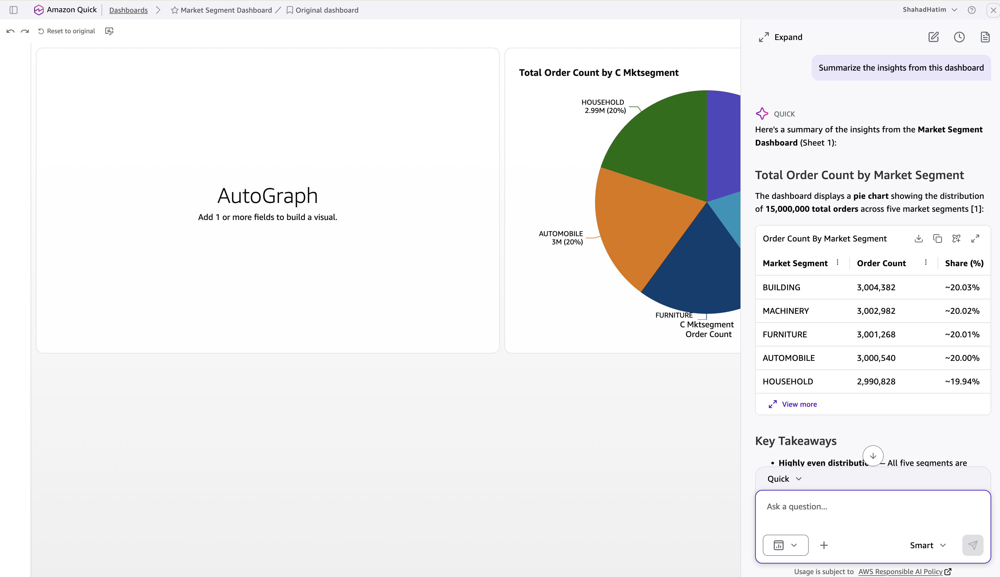

### Create a Space and chat agent grounded in the workshop data
I created the **Customer Revenue & Segmentation** Space and the **Revenue Analytics Assistant** chat agent. When I asked it to compare revenue across segments over time, it said the dataset has no date columns, so a quarterly comparison isn't possible. It then answered from the data it does have: total revenue by segment, from BUILDING ($436.36B) to HOUSEHOLD ($434.84B).

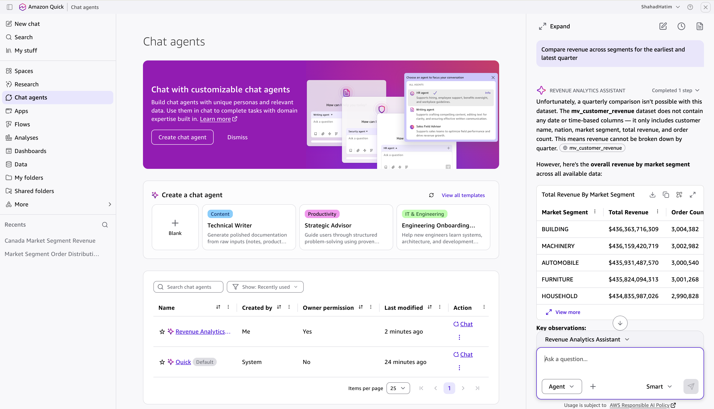

---

## Track 2: Explore Quick Desktop (20 pts)

### Signed-in Desktop session and working AWS MCP connection
I set up AWS CLI credentials in `~/.aws/credentials`, verified them with `aws sts get-caller-identity`, and added a local MCP connector in Quick Desktop that runs `mcp-proxy-for-aws`. The screenshot shows my signed-in account and the 8 tools the server exposes. My version lists `run_script` (which runs boto3 code against my account) instead of the `call_aws` tool named in the workshop, but it does the same job.

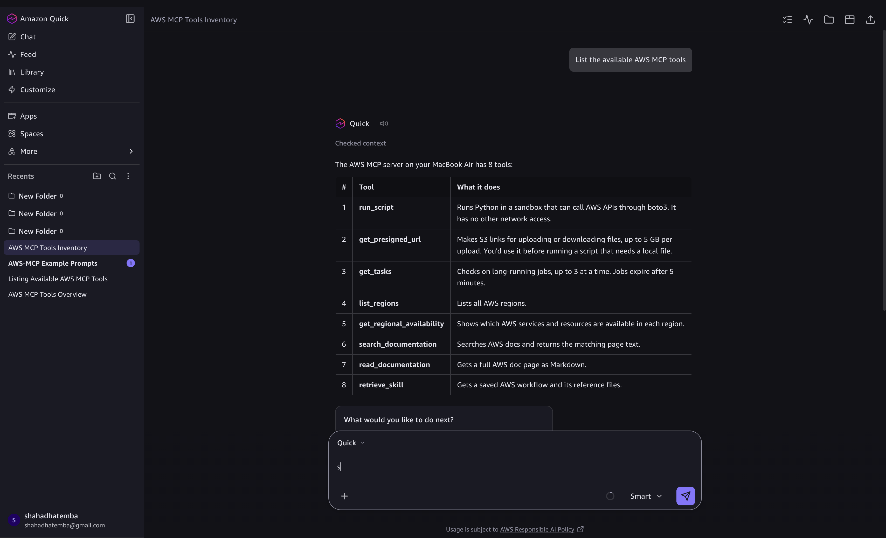

### Redshift data and the revenue view
At first Quick could not see my tables. It connects to Redshift as the IAM-mapped database user `IAMR:WSParticipantRole`, while my tables were owned by `awsuser`. After I granted `SELECT` on the `public` schema, Quick listed `customer`, `orders`, `lineitem`, `nation` and `mv_customer_revenue`.

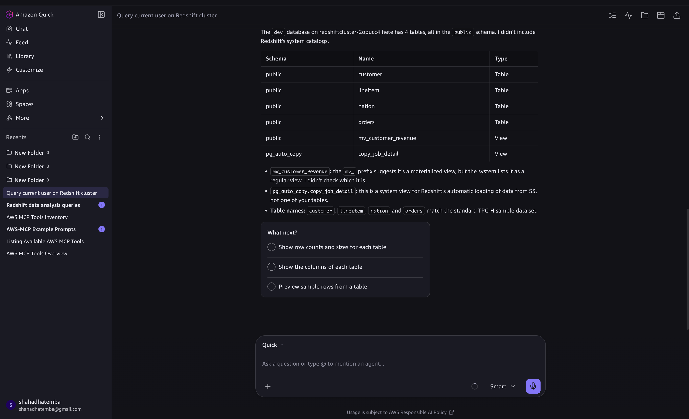

### Natural-language question, chart, and explanation
**Question:** *Which market segment generated the most revenue in Canada? Show it as a bar chart.*

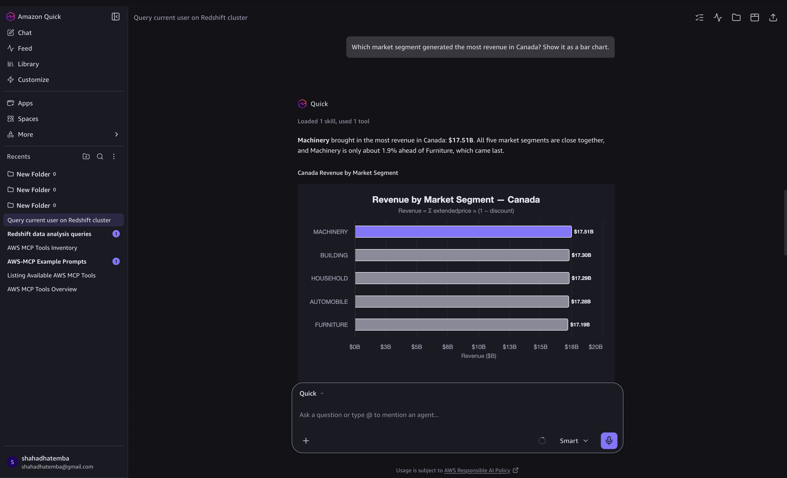

**What the chart shows:** MACHINERY generated the most revenue from Canadian customers, at about $17.51B. All five segments are very close, and MACHINERY is only about 1.9% ahead of FURNITURE, the lowest. TPC-H customers are spread almost evenly across segments, so no single segment dominates.

To check the answer, I asked Quick to show the SQL it ran ([screenshot](screenshots/2c_generated_sql.png)). It joins `customer` to `nation` to filter on `CANADA`, then to `orders` and `lineitem`. It computes revenue as `SUM(l_extendedprice * (1 - l_discount))` grouped by segment, which matches the revenue definition in the materialized view.

---

## Track 3: Agentic AI Analytics with Athena and Quick (20 pts)

### Create and query the lakehouse tables
I built the same TPC-H data in three storage formats:

| Table | Format | Query result |
|---|---|---|
| `customer_csv` | External table over raw CSV in S3 | 10 rows, 2.655 s, 1.78 MB scanned ([screenshot](screenshots/3a_customer_csv.png)) |
| `orders_iceberg` | Iceberg (Parquet, partitioned by `o_orderdate`), created with CTAS | 10 rows, 1.467 s, 38.85 KB scanned |
| `lineitem_csv_s3_table` | Amazon S3 Tables (managed Iceberg) | 10 rows, 1.406 s, 24.67 MB scanned ([screenshot](screenshots/3a_lineitem_s3_table.png)) |

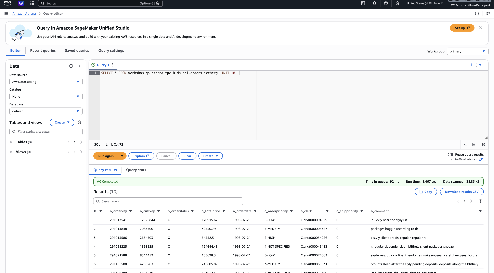

### Prepare and join Quick datasets
I created Quick datasets for each table through the `tpch-lakehouse-athena` data source ([customer_csv dataset](screenshots/3b_customer_csv_dataset.png)). I then built **TPC-H Unified (Joined)**, which combines customer, order and line-item columns: customers to orders on the customer key, and orders to line items on the order key. It has 17 columns and 15,708,187 rows in SPICE.

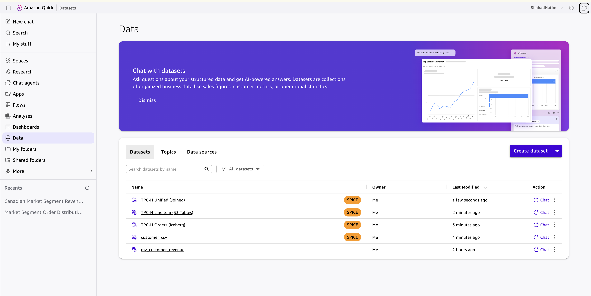

### Build a Topic and publish a dashboard
I created the **TPC-H Analytics** Topic over the TPC-H customer, order and line-item data ([Topic screenshot](screenshots/3c_topic.png)). I published the **TPC-H Lakehouse Analytics** dashboard, with Executive Overview and Customer & Operations sheets.

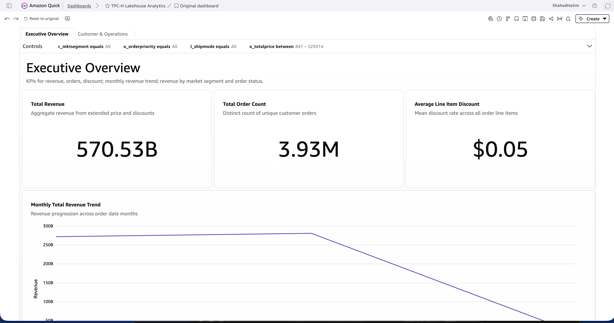

### Knowledge base, Space, and agent answer with identifiable sources
I created the **TPC-H Reference Knowledge Base** with a web crawler on the TPC-H v2.17.1 specification PDF, and the **TPC-H Lakehouse Analytics Space** containing the Topic, the knowledge base and the dashboard. I also created the **TPC-H Analytics Agent** linked to that Space ([agent configuration](screenshots/3d_agent_config.png)).

My first answer from the agent had no citation, because I had added only the Topic to the Space. After I added the knowledge base and dashboard, the agent cited **Clause 2.4.3 (Shipping Priority Query, Q3) of the TPC-H Standard Specification, Revision 2.17.1**, with links to the indexed PDF ([source section](screenshots/3d_agent_answer_sources.png)).

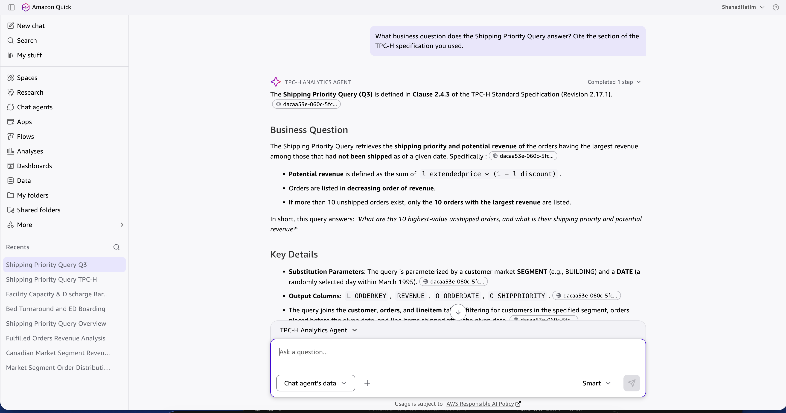

---

## Track 4: Hospital Operations BI with Quick (20 pts)

### Prepare the Redshift warehouse and working Quick data sources
On the Redshift Serverless workgroup `redshift-dw-wg`, I created the `hospital_ops` schema, loaded the three JSON domains from S3 (1000 patient-flow, 800 discharge-barrier and 600 transfer records), and built three materialized views ([mv_unit_capacity result](screenshots/4a_redshift_mv.png)).

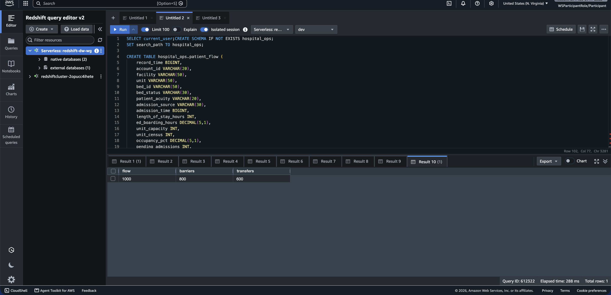

Redshift Serverless and PostgreSQL are private, so I created the VPC connection `HospitalOpsVPC` and used it for both data sources. Athena connects directly. The result is eight direct-query datasets: 3 from Athena, 2 from Redshift and 3 from PostgreSQL ([datasets list](screenshots/4a_data_sources.png)).

### Publish an operations dashboard
I published the **Hospital Operations Command Center** dashboard. The screenshot shows the Capacity & Discharge Barriers view: occupancy by facility and unit, ED boarding hours by weekday, and barrier counts by type and owner.

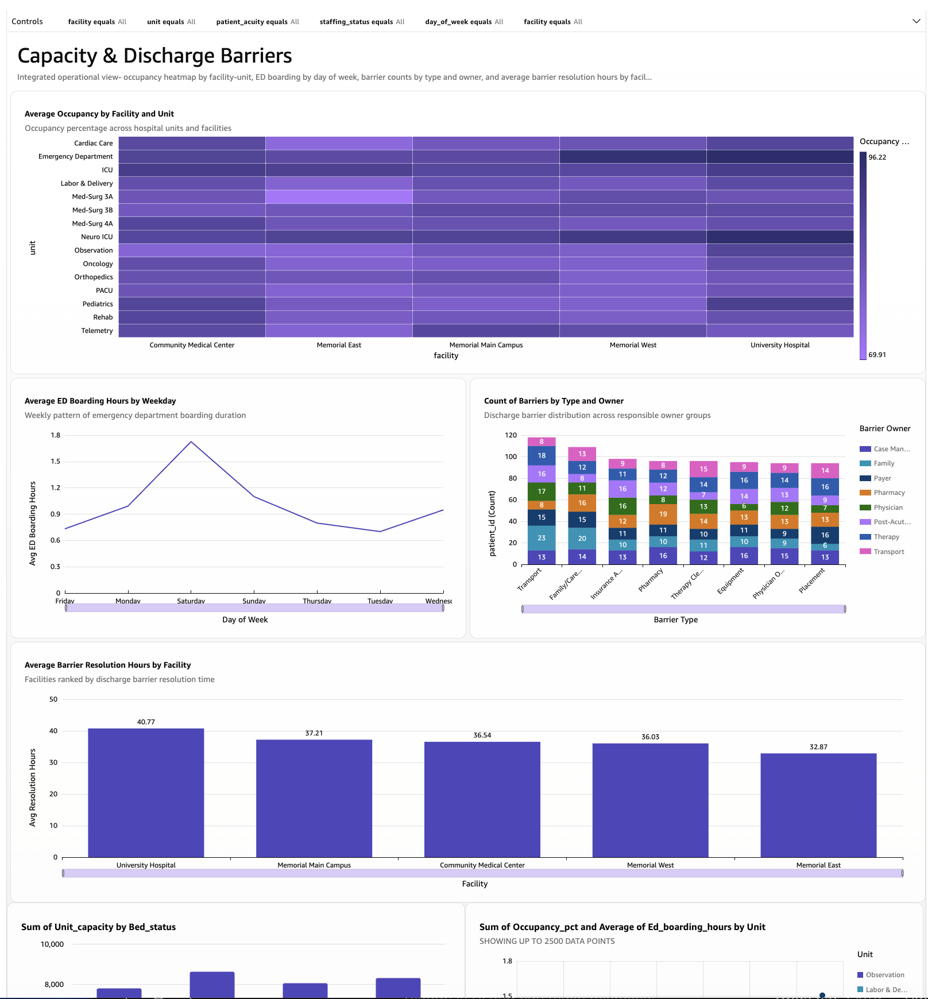

### Topics, a Space, and a grounded cross-domain agent answer
I created three Topics (Patient Flow & Capacity, Discharge Throughput & Barriers, and Transfer Center & Bed Turnaround). I then created the **Hospital Operations Command Center** Space, holding the Topics, the dashboard, the three PostgreSQL datasets and the five SOP documents. A cross-domain question about bed turnaround and ED boarding drew on both the Transfer Center and Patient Flow Topics. For example, Memorial Main Campus has the second-slowest turnaround but the lowest ED boarding.

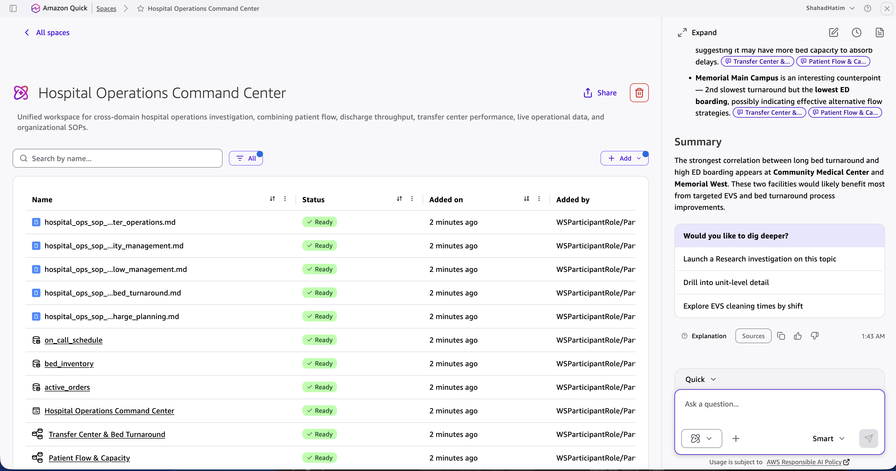

The **Hospital Operations Analyst** agent also combined discharge-barrier data with the discharge-planning SOP. It cited **SOP-DCP-001 §5.2** (12-hour escalation for complex barriers, 6 hours for simple ones) ([agent answer](screenshots/4c_agent_answer.png)).

### Run the capacity, barrier, and transfer reporting Flows
I ran all three Flows: the Daily Capacity Forecast, the Discharge Barrier Escalation Report and the Weekly Transfer Scorecard.

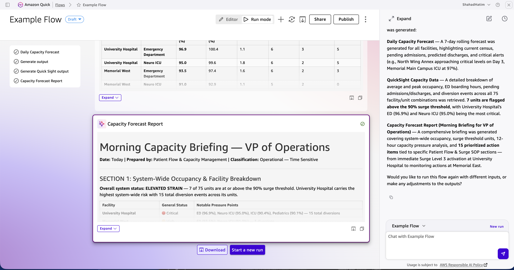
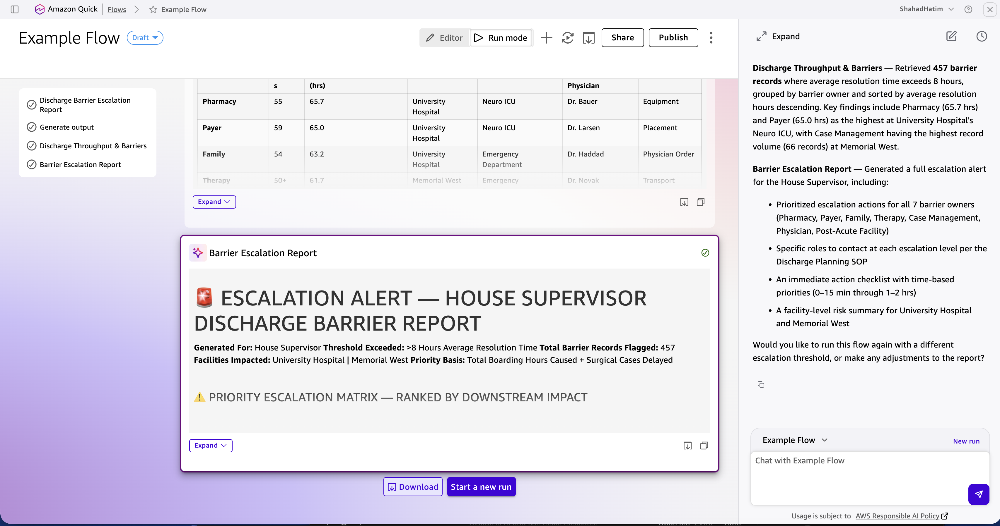
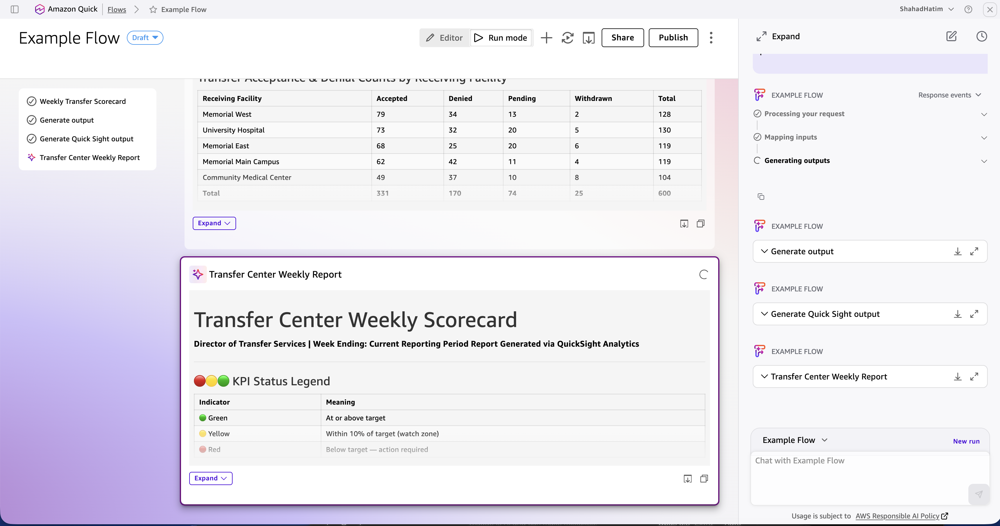

---

## Track 5: Athena Direct Query to SPICE with Quick (20 pts)

### Query raw S3 data and record a baseline
I ran monthly net revenue by market segment (June–December 1998) directly on the raw TPC-H CSV files. **Baseline: 6.822 s, 92.27 GB scanned.** A second run took 6.456 s and scanned the same amount ([screenshot](screenshots/5a_baseline_query_run2.png)). CSV is not columnar and these files are not partitioned, so Athena has to read every file in full even with a date filter.

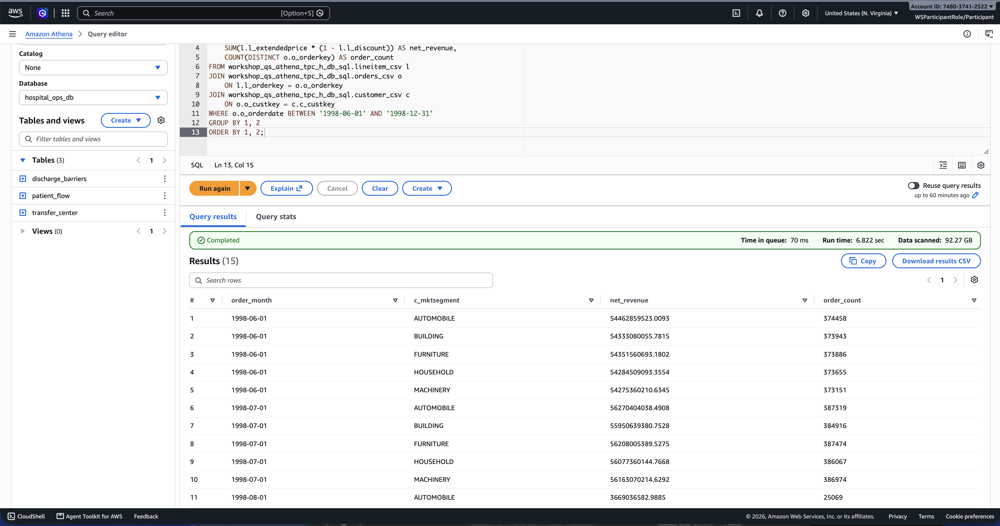

### Publish a Direct-query dashboard
I created the **TPC-H Revenue (Direct Query)** dataset from the same SQL, in direct query mode. I published a dashboard with a monthly revenue line chart, revenue by segment, and KPI cards for total net revenue and order count. Every visual sends a query to Athena when it loads.

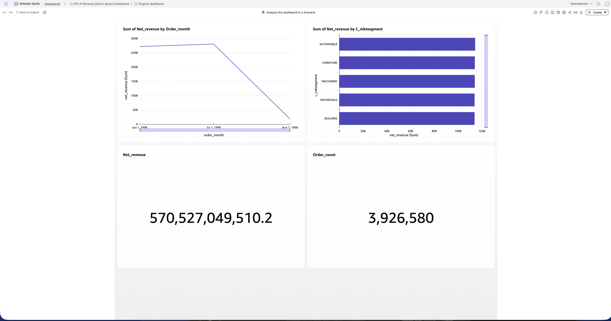

### Build an Iceberg / pre-aggregated data product and compare with the baseline
I created `revenue_by_segment_monthly`, a pre-aggregated Iceberg table (Parquet) that stores the joined and summed result once.

| Query | Run time | Data scanned |
|---|---|---|
| Baseline: raw CSV join | 6.822 s | 92.27 GB |
| Pre-aggregated Iceberg data product | 0.768 s | 0.50 KB |

Same answer, about **89% faster**, and **over 99.9999% less data scanned**. Athena charges by data scanned, so the cost drops just as sharply. The expensive join happens once, when the table is built, instead of on every query.

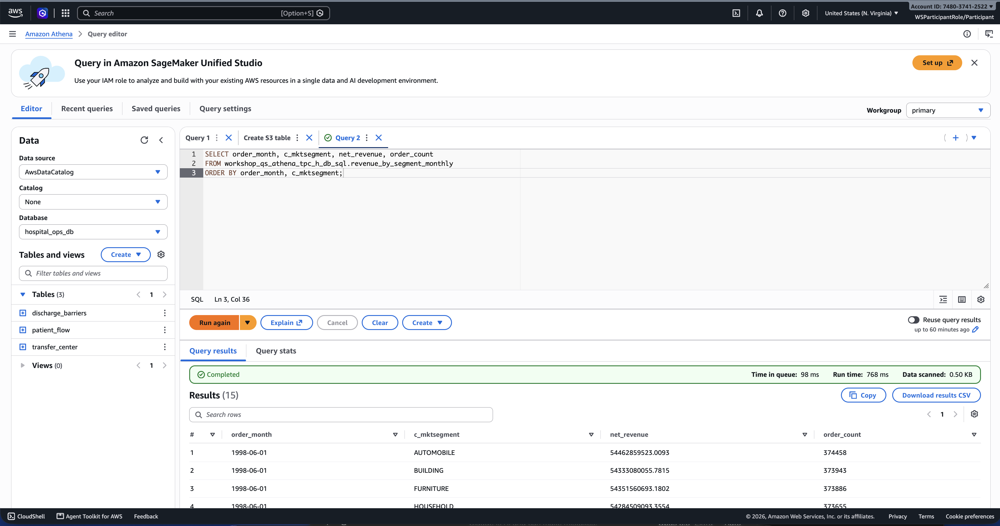

### Load a selective SPICE dataset and explain when each mode fits
I loaded only what a fast dashboard needs into SPICE: 4 columns (`order_month`, `c_mktsegment`, `net_revenue`, `order_count`) for the last two months, from the pre-aggregated table. That is **10 rows and 690 bytes**. The workshop example filters from November 1998, but the TPC-H orders end in early August 1998, so I used July–August 1998 as the most recent two months.

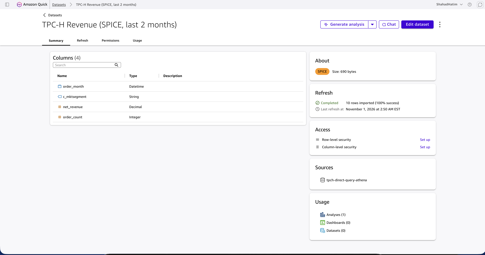

**When each mode fits:**
- **Direct query on raw S3** is best for exploring new data with no setup. It gives a real answer immediately, but every query re-scans everything (92 GB here).
- **Direct query on Iceberg or a pre-aggregated table** is best for questions asked repeatedly. Columnar files and pre-computed results make each query tiny (0.50 KB here) while the data stays fresh in Athena.
- **SPICE** is best for a dashboard that must be instant for many users. Data is served from memory, independent of Athena, but it is a copy that has to be refreshed. So load a small, selective slice, not all columns and all history.

---

## Issues I ran into
- **AWS credentials file:** The workshop's credential panel gives shell `export` commands, but `~/.aws/credentials` needs a `[default]` section with `key = value` lines.
- **Quick Desktop could not start `uvx`:** Desktop apps don't inherit the terminal's PATH, so I used the full path `/opt/homebrew/bin/uvx`.
- **Quick couldn't see my Redshift tables:** Quick connects as `IAMR:WSParticipantRole`, so I granted `SELECT` to that user (via `PUBLIC`).
- **Hospital tables on the wrong Redshift:** I first ran the Track 4 SQL on the provisioned cluster, but Quick's data source points to the Serverless workgroup. I reloaded the tables there.
- **S3 Tables bucket name "already taken":** I was creating a general purpose bucket, but the step needed a table bucket, which only has to be unique within my account.
- **`PERMISSION_DENIED` from Athena in Track 5:** Track 4 had switched Quick to `cfn-QuickRole`, which can't read the public TPC-H bucket. I switched back to the Quick-managed role and granted S3 access to the workshop buckets and `redshift-downloads`.
- **Agent with no citations:** The Space was missing the knowledge base. Adding it fixed the sources.
